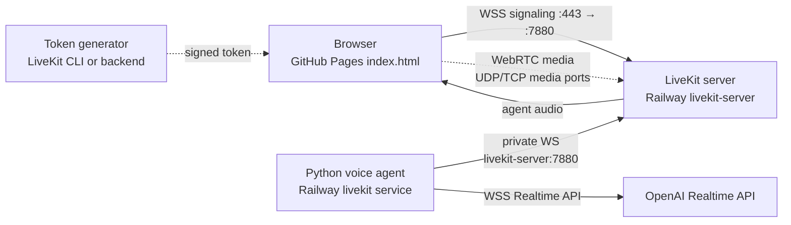

# Minimal self-hosted LiveKit

This is the smallest local setup: a LiveKit server and a Python agent started by
Docker Compose. The agent's dependencies are managed with `uv` and pinned in
`agent/uv.lock`.

## Start it

The agent uses OpenAI's Realtime API, so provide an OpenAI API key before
starting:

```bash
export OPENAI_API_KEY=your-openai-api-key
docker compose up --build
```

The services are then available at:

- LiveKit signaling/API: `ws://localhost:7880`
- LiveKit TCP media: `localhost:7881`
- LiveKit UDP media: `localhost:7882`

The development server uses these credentials:

```text
LIVEKIT_API_KEY=devkey
LIVEKIT_API_SECRET=secret
```

The agent registers with LiveKit and waits for a room job. Each connection uses
a simple `AgentSession` with OpenAI's `gpt-4o-mini-transcribe` for speech-to-text,
`gpt-4.1-mini` for replies, and `gpt-4o-mini-tts` with the `marin` voice for
speech output. The assistant is helpful, cheerful, and concise.

Follow the agent logs with:

```bash
docker compose logs -f agent
```

The agent registers a Phoenix OpenTelemetry provider and exports LiveKit's
built-in traces to the local collector over OTLP/HTTP. Open
`http://localhost:6006` to inspect session, turn, STT, LLM, and TTS spans,
including transcripts, latency, token usage, and audio duration. When a session
closes, the agent also adds a `voice.session.audio` span containing the captured
input and output as inline WAV data URIs. Traces use the `livekit-agent` project,
are grouped by room name, and persist in the `phoenix-data` Docker volume.

Raw voice audio is sensitive. This local setup includes it only for development.
`OPENINFERENCE_BASE64_AUDIO_MAX_LENGTH` controls the maximum encoded size per
input/output recording and defaults to 2,000,000 characters.

## Use the browser client

`index.html` uses the official `livekit-client` browser library, daisyUI, and
Tailwind's browser build. Serve the directory locally, for example:

```bash
npx serve .
```

Open the displayed URL, then generate a local development token in another
terminal:

```bash
lk token create \
  --api-key devkey \
  --api-secret secret \
  --join \
  --room demo-room \
  --identity web-user \
  --valid-for 24h
```

Paste the resulting token into the page and connect to `ws://localhost:7880`.
Use a unique room and token for each connection. Enable the microphone or
camera after connecting. The agent greets the participant and asks how it can
help.

The official LiveKit UI components are React-based, so this page uses the
official browser client directly and provides its own plain HTML controls.
Never expose an API secret in a production frontend; generate tokens from a
backend instead.

## Networking

The browser page is static and can be hosted by GitHub Pages. It connects to
LiveKit for signaling over the public `wss://` domain. The agent uses Railway's
private network to connect to LiveKit, while its OpenAI Realtime connection is
outbound to OpenAI.



Port roles:

- `7880`: LiveKit HTTP/WebSocket signaling. The Railway public domain targets
  this port.
- `7881`: LiveKit TCP media fallback, exposed through Railway's TCP proxy when
  available.
- `7882` or the configured UDP range: LiveKit WebRTC media. Railway's HTTP
  domain does not provide public UDP, so TURN or another UDP-capable host may
  be needed for reliable audio/video.
- `8081`: the agent's internal health/metrics HTTP server; it is not the
  browser's LiveKit URL.

Stop everything with:

```bash
docker compose down
```

## Notes

This intentionally uses LiveKit's `--dev` mode and fixed development
credentials. It is suitable for local experiments only. Before deploying,
replace dev mode with a real LiveKit configuration, generate strong API
credentials, and configure TLS, firewall rules, and the required media ports.
